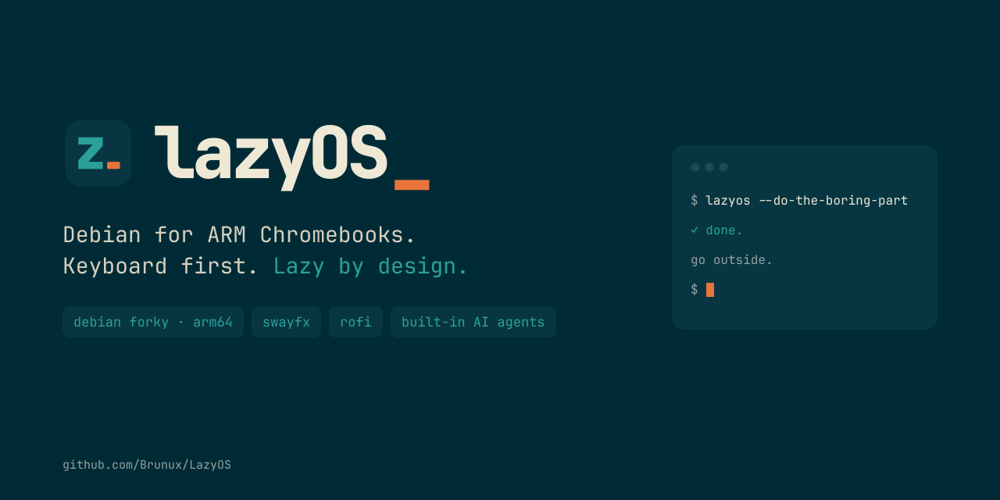
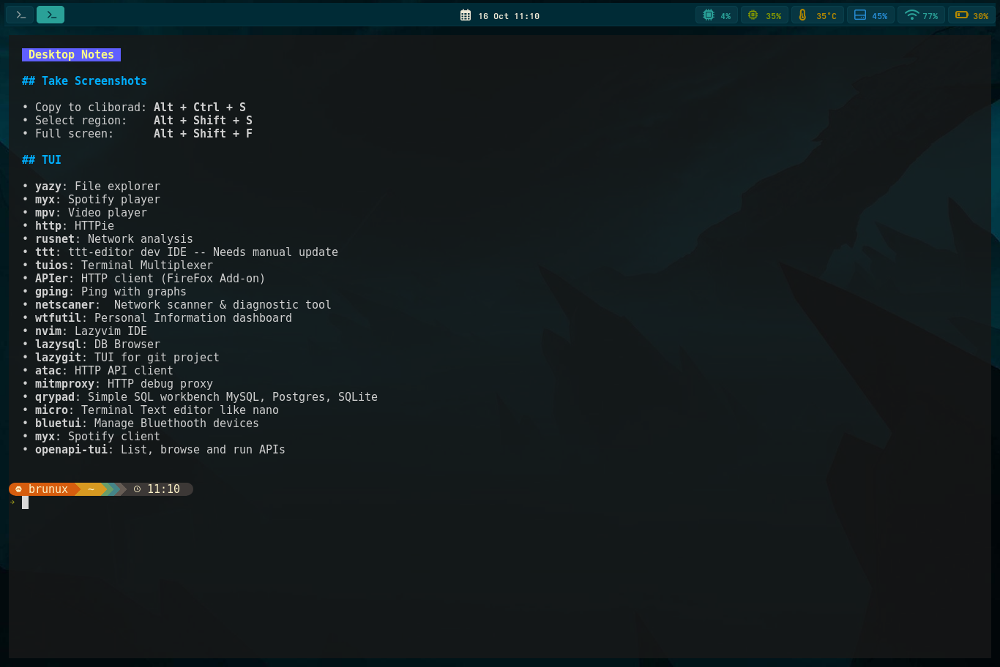
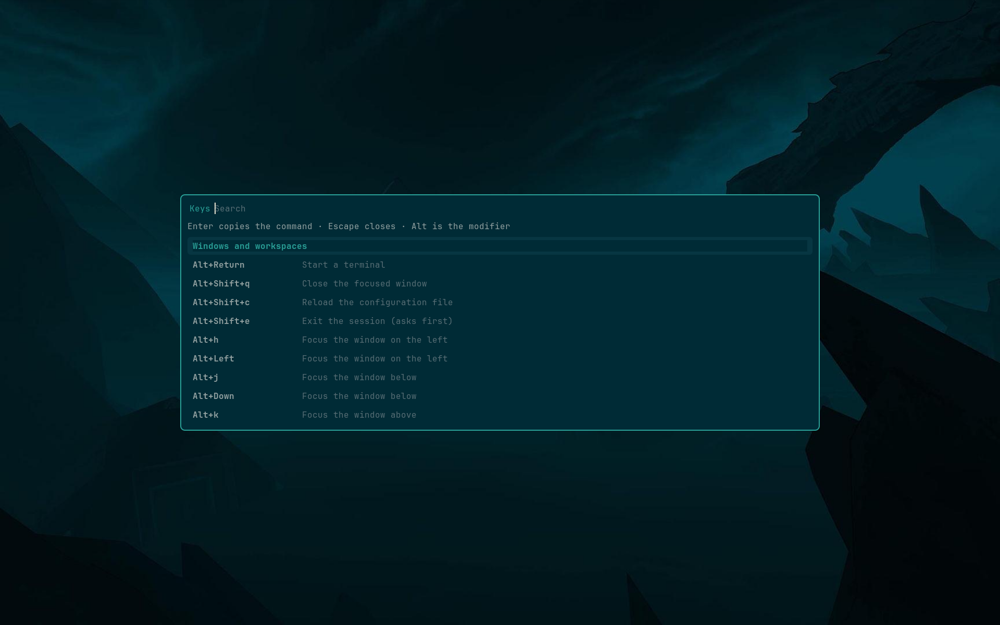
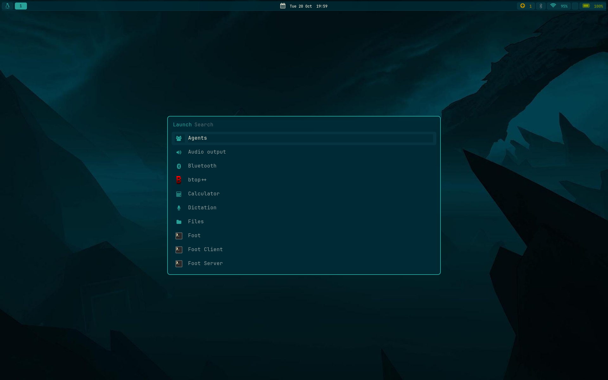
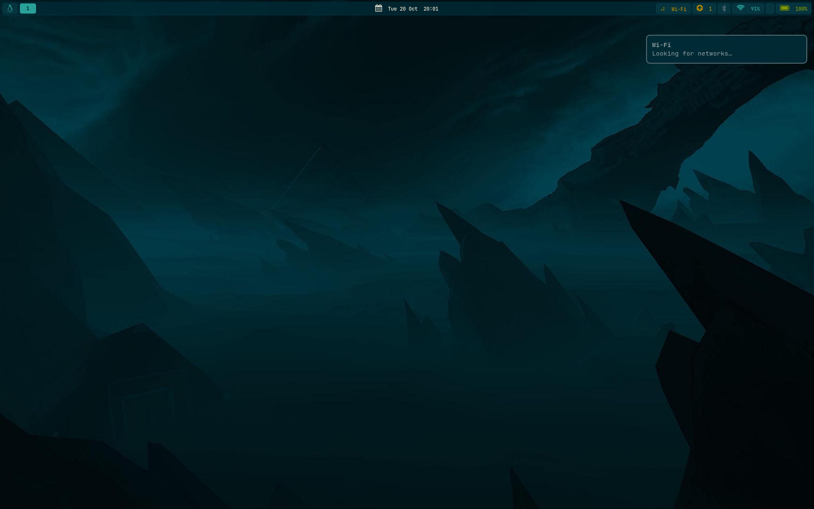

<p align="center"></p>

# LazyOS

**Website:** [brunux.github.io/LazyOS](https://brunux.github.io/LazyOS/) · **Brand:** [`brand/`](brand/README.md)

**LazyOS** (`lazy by design`) is a Debian (**forky**, arm64) system for Nura-supported devices.
It is built by a **device-agnostic** port framework that reuses Nura's (postmarketOS') hardware
support — kernel, device tree, patches, modules and boot flow — instead of Alpine.

First target: the **Google Hayato** Chromebook (MediaTek MT8192, `google-asurada`).

- **Status:** boots from microSD on the Hayato with the Nura-ported sway session (display,
  input, storage, Wi-Fi, Bluetooth, audio, suspend, greeter), and the hardware report of the
  booted image comes back clean (kept in [`reports/`](reports/)). The eMMC install works and is
  validated on hardware, and the running installation can be backed up and restored
  (`scripts/backup-system.sh`, `scripts/restore-system.sh`).
- **Release:** [`v0.3.1`](docs/releases/v0.3.1.md) — the precompiled image, with the **LazyOS**
  brand (the mark and the distribution's own identity) and the session this repository documents:
  **swayfx** with blur, **rofi** for the launcher, the window switcher and
  the bar's menus, the file browser and its viewers, the manual, **capture**, **download**,
  **dictation**, **agents**, tablet mode, and the **LazyOS** idle screen and lock (see
  [Using the system](#using-the-system)).
- **Using it:** [Using the system](#using-the-system) below, and the manual that ships in the image
  (`/usr/share/doc/lazyos/`, or **Learn** in the launcher) - its sources are
  [`uis/sway/files/usr/share/doc/lazyos/`](uis/sway/files/usr/share/doc/lazyos/).
- **The session in detail:** [`uis/sway/README.md`](uis/sway/README.md) · **the compositor:**
  [`compositors/swayfx/README.md`](compositors/swayfx/README.md)
- **Measured device tuning:** [`docs/optimization.md`](docs/optimization.md)
- **What of Omarchy can move onto rofi:** [`docs/plan-rofi.md`](docs/plan-rofi.md) ·
  **the agents feature, phased:** [`docs/plan-agents.md`](docs/plan-agents.md)
- **Plan:** [`docs/plan.md`](docs/plan.md) · **Recon of the reference machine:**
  [`docs/recon.md`](docs/recon.md) · **hardware reports:** [`reports/`](reports/)
- **Agent/build instructions:** [`AGENTS.md`](AGENTS.md)



*An early build of the ported session on the Hayato: waybar over the terminal with the solarized
theme. Today's bar carries more modules (menu, workspaces, updates, tray, keyboard layout,
Bluetooth, network, volume, brightness, battery).*

> **Note on how this project is developed:** the work is carried out **by an AI agent running on
> [OpenCode](https://opencode.ai)** together with the maintainer (see
> [Development process](#development-process)). CI/CD is not wired up yet, but the repository is
> laid out so it can be added later.

---

## Download and flash a precompiled image

The [`v0.3.1`](docs/releases/v0.3.1.md) release publishes the image built from this repository:

| asset | what it is |
|---|---|
| `google-asurada.img.xz` | the disk image: the three ChromeOS GPT partitions (kernel, `/boot`, root), ready for `dd` |
| `google-asurada-rootfs.tar.zst` | the same root filesystem as a tarball, with `/boot` inside it, for building a card by hand |
| `google-asurada.vmlinuz.kpart` | the signed FIT kernel partition that matches that image |
| `SHA256SUMS` | SHA-256 of the three assets above |

```sh
sha256sum -c SHA256SUMS
xz -dc google-asurada.img.xz | sudo dd of=/dev/mmcblk1 bs=4M conv=fsync
```

On the Chromebook: developer mode, `crossystem dev_boot_usb=1 dev_boot_signed_only=0`, insert the
card and pick **external disk** in the firmware menu. It comes up silently to a greetd prompt —
user `brunux`, password `debian`, passwordless sudo. **Change the password** (`passwd`) before using
it for anything real.

The image is 6 GiB, so a larger card keeps the space after `p3` unused. To use the whole card,
write the tarball instead: `write-sd.sh` sizes `p3` to the device it is given.

```sh
sudo tar -xpf google-asurada-rootfs.tar.zst -C /mnt/rootfs   # as root, so owners and ACLs survive
ROOTFS=/mnt/rootfs sudo scripts/write-sd.sh /dev/mmcblk1     # from a clone of this repository
```

The released image carries **no saved Wi-Fi networks** and no host identity: the build rootfs
deliberately keeps the maintainer's profiles (see [Quick start](#quick-start)), so a published
artifact is sanitized and asserted clean by [`scripts/lib-dist.sh`](scripts/lib-dist.sh).

To install on internal storage, boot the card and run `CONFIRM=yes sudo scripts/install-emmc.sh`
from the on-image copy of the repository: it writes `/dev/mmcblk0` and destroys whatever is there.

---

## Using the system

What the image boots into, and how to learn the rest without leaving the machine. Everything
here is also in the manual the image carries: **Learn** in the launcher, or `/usr/share/doc/lazyos/` on
the machine, or the same files under
[`uis/sway/files/usr/share/doc/lazyos/`](uis/sway/files/usr/share/doc/lazyos/) here.

### First login

User `brunux` (or the one the image was built with), password `debian`, passwordless `sudo`.
**Change the password** (`passwd`) before using it for anything real.

### The session

| Piece | What it is |
|---|---|
| compositor | **swayfx** (a sway fork) with rounded corners, shadows and a blurred backdrop under the translucent terminal, launcher and bar |
| bar | **waybar**: menu, workspaces, clock, updates, tray, keyboard layout, Bluetooth, network, volume, brightness, battery - each click opens a short-lived **rofi** list |
| terminal | **foot** (solarized) |
| launcher | **rofi**: applications (`-show drun`, with the icons of a small theme rendered from the icon fonts), windows (`-show window`), commands (`-show run`), and the bar's own menus (`-dmenu`) |
| notifications | **mako**, under the bar |
| idle | the screensaver at 150 s, the lock at 300 s |
| manual | **Learn**, seven pages rendered with **glow** in foot |
| browser | **firefox-esr**, the image's one viewer: the file browser hands it anything that is not text |

### The keys worth knowing on day one

| Keys | Does |
|---|---|
| **Search** (or Alt+D) | launcher |
| Alt+Space | root menu (the bar's menu button on the keyboard) |
| Alt+Tab | window switcher (sway has none of its own) |
| Alt+Shift+D | command palette (`$PATH`; Shift+Enter runs it in foot) |
| **Alt+Ctrl+K** | every key binding, searchable, generated from the configuration |
| Alt+Return | terminal · Alt+Q: close a window · Alt+grave: scratchpad |
| Alt+Ctrl+A / B / W / P | audio, Bluetooth, network and power panels |
| Alt+Ctrl+F | files: browse a directory, read a text file in foot, anything else in Firefox |
| Alt+Ctrl+O / N / Q | settings (radios, night light, touchpad, rotation) · notifications · calculator |
| **Lock key** (or Alt+Ctrl+L) | locks, and logind suspends a moment later |
| Alt+Escape | system panel (lock, suspend, log out, reboot, power off) |
| Alt+Ctrl+X | dictation · Alt+Ctrl+Shift+A: agents · Alt+Shift+E: exit the session (asks first) |

The letters are Omarchy's, with `Alt` where Omarchy uses `Super`; the manual's
*Shortcuts* page lists the three deliberate deviations and the whole mapping.



*Alt+Ctrl+K: every binding, parsed from the session's own files, Enter copies the command.*

The full tour is the manual's *Shortcuts* page, and the live list is Alt+Ctrl+K.



*The launcher. Debian's Adwaita has no application icons, so the session ships a small **LazyOS**
theme: the same Font Awesome codepoints the bar and the menus draw, rendered once to 48x48 PNGs by
`scripts/make-icons.sh`. Applications that bring their own icon still show theirs.*

### Slow actions say so twice

A scan, a connection, a `du` walk: anything that takes seconds opens a **mako card** that does not
expire and *becomes* the result, and puts a **spinner on the bar** with the name of the task. Both
disappear when the action ends; nothing stays resident.



*`busy start wifi Wi-Fi 'Looking for networks…'` while `nmcli` rescans; `busy end wifi "9 networks
in range"` turns the card into the answer.*

### Features that are one script each

* **Learn** - the manual, in the launcher and the root menu.
* **Dictation** (Alt+Ctrl+X) - `parecord` → `whisper-cli` → `wtype`; the 78 MB model is fetched on
  first use and verified. No daemon.
* **Agents** (Alt+Ctrl+Shift+A) - launch Claude Code / Codex / OpenCode / Gemini / Copilot, install
  one with npm (into `~/.local`, never `/usr/local`), and keep **accounts** per agent (Claude Code
  via `CLAUDE_CONFIG_DIR`, Codex via `CODEX_HOME`). **OpenCode is already installed**: it is the
  agent this port is built with, so the image ships it in `~/.opencode/bin` (pinned in
  [`tools/opencode/`](tools/opencode/), where its own `opencode upgrade` can replace it without
  root). Usage meters are planned, not built; see [`docs/plan-agents.md`](docs/plan-agents.md).
* **Hibernate** - refused unless a **disk** swap (not zram) of at least 2/5 of RAM exists *and* the
  kernel command line carries `resume=` (a swap partition labelled `lazyos_swap` is the intended
  wiring). Each missing condition says what to do.
* **Auxiliary swap** - Places → **Auxiliary swap** (also the root menu): pick a card, confirm, and it
  becomes a `lazyos_swap` partition that is active now and on every boot, with priority 10 so zram
  (100) is used first. The same disk list as Format a disk; `nofail` and a 15 s device timeout keep
  a boot without the card clean. The **Turn it off** row undoes it.
* **Screenshots** - region, full screen, or region to the clipboard.

### The terminal

`ls` is **eza**, `cat` is **bat**, `cd` jumps with **zoxide**, `Ctrl+R`/`Ctrl+T`/`Alt+C` are
**fzf**, `rg` is ripgrep, `fd` is find, the prompt is **starship**, and `tmux`, `btop`, `lazygit`,
`tldr`, `ffmpeg`, `yt-dlp`, `jq`, `tesseract`, `zbarimg`, `qrencode` are there.
`man <tool>` and `tldr <tool>` explain the rest; the manual's *Software* page has the table.

### Health, updates and the boot partition

```sh
check-system.sh ~/Dev/LazyOS     # OK/WARN/FAIL, one line per check (also /usr/local/sbin)
```

The kernel is **inside** the ChromeOS kernel partition (`p1`), not only in `/boot`, so after a kernel
update the partition has to be rewritten: `sudo ~/Dev/LazyOS/scripts/install-kpart.sh`. The
manual's *The system* page explains the layout, suspend, hibernate, backups and the firmware menu.

### Where to read more

| Topic | File |
|---|---|
| the manual as shipped (welcome, rofi, shortcuts, software, the system, troubleshooting, agents) | [`uis/sway/files/usr/share/doc/lazyos/`](uis/sway/files/usr/share/doc/lazyos/) |
| the session: bar, launcher, idle screen, CLI tools, deviations from Nura | [`uis/sway/README.md`](uis/sway/README.md) |
| the compositor: why swayfx, its effects policy, the packaging | [`compositors/swayfx/README.md`](compositors/swayfx/README.md) |
| why the device is tuned the way it is (MGLRU, schedutil, HZ, zram, THP) | [`docs/optimization.md`](docs/optimization.md) |
| what of Omarchy's desktop can move onto rofi, and ideas from other distros | [`docs/plan-rofi.md`](docs/plan-rofi.md) |
| what Omarchy has and this port does not (packages, sizes, features, verdicts) | [`docs/omarchy-gap.md`](docs/omarchy-gap.md) |
| the agents feature, phased, and the "thin layer" decision | [`docs/plan-agents.md`](docs/plan-agents.md) |
| every engineering gotcha (boot chain, keyd, audio, suspend, fonts, packages) | [`AGENTS.md`](AGENTS.md) |
| hardware validation evidence | [`reports/`](reports/) |
| the release notes and the plan | [`docs/releases/`](docs/releases/), [`docs/plan.md`](docs/plan.md) |

## Architecture

Devices and kernels are decoupled, so a new port is a new directory (and only a new kernel
directory if the kernel differs):

```
devices/<codename>/        one directory per device
  deviceinfo               pmaports-style device description (sourceable shell)
  kernel                   kernel flavor to use (name under kernels/)
  kernel-cmdline.conf      base kernel command line (one option per line)
  modules-initfs           modules forced into the initramfs (one per line)
  packages.list            device-specific Debian packages (e.g. firmware)
  APKBUILD.reference       upstream device package (reference only)
kernels/<flavor>/          one directory per kernel (shared by devices)
  version                  upstream version, e.g. 7.2.7
  config.aarch64           kernel config (CONFIG_LOCALVERSION gives the release suffix)
  patches/*.patch          patches
  patches/series           apply order, one filename per line
  APKBUILD.reference       upstream kernel package (reference only)
compositors/<name>/        one directory per compositor built from source
  version                  upstream version, e.g. 0.6
  scenefx-version          the effects library it links against
  SHA256SUMS               tarball checksums, verified on every build
  README.md                what it is, why it is built here, its effects policy
uis/<ui>/                  one directory per graphical shell (sway, ...)
  packages.list            packages to install (Debian names)
  files/                   tree overlaid onto the rootfs (etc/ as root,
                           home/ merged into the user's home)
  README.md                what the shell ships and how it differs upstream
packages/                  device-agnostic package lists (base.list, tools.list)
scripts/
  lib.sh                   resolves device + kernel + UI, shared config
  lib-cgpt.sh              the ChromeOS GPT layout (kernel + boot + root)
  lib-dist.sh              what a published artifact must not carry
  00-deps.sh               host build dependencies (apk)
  build-kernel.sh          download + patch + build + stage the kernel
  build-swayfx.sh          build scenefx + swayfx and package them as .debs
  build-rootfs.sh          debootstrap the Debian rootfs
  install-kernel.sh        copy the staged kernel into the rootfs, build the initramfs
  install-swayfx.sh        install the compositor .debs (rootfs, or `/` on a running system)
  make-kpart.sh            build the signed depthcharge FIT kpart
  write-sd.sh              partition + populate a microSD/USB
  make-image.sh            build a distributable disk image (no card needed)
  make-release.sh          build every asset of a release, with checksums
  install-emmc.sh          install the running system onto internal storage
  install-kpart.sh         rewrite the kernel partition the system booted from
  backup-system.sh         back up the running installation into a directory (restorable)
  restore-system.sh        restore such a backup onto a disk (root only, from the live SD)
  check-system.sh          hardware + configuration report (runs on the booted image)
  build.sh                 the full pipeline (no block devices touched)
docs/                      plan, recon, optimization, plan-rofi, plan-agents,
                           release notes, screenshots
reports/                   check-system.sh output captured on real hardware
```

`scripts/lib.sh` reads `devices/<codename>/deviceinfo` and `devices/<codename>/kernel` and
resolves everything: architecture, DTBs, depthcharge board, kpart geometry, kernel
version/release. Select a device with `DEVICE=<codename> scripts/...` (with a single device it is
picked automatically).

The graphical shell is a separate axis: `uis/<name>/` holds its package list and a file tree that
`build-rootfs.sh` stages and `rootfs-setup.sh` installs. Select it with `UI=<name>` (default
`sway`). `uis/sway/` ports the maintainer's Nura session on top of **swayfx** (the wlroots fork
built from [`compositors/swayfx/`](compositors/swayfx/README.md), with rounded corners, shadows and
blur behind the translucent terminal, launcher and bar) — see [`uis/sway/README.md`](uis/sway/README.md) for the layout and the
deliberate deviations.

### What comes from Nura and what is Debian

| Nura (Alpine/apk) | Here (Debian) |
|---|---|
| `device-google-asurada` (APKBUILD + deviceinfo) | `devices/<codename>/` |
| `linux-postmarketos-mediatek-mt81` | `kernels/<flavor>/` (same source + config) |
| `postmarketos-mkinitfs` | `initramfs-tools` |
| `boot-deploy` | `scripts/make-kpart.sh` |
| `depthcharge-tools`, `cgpt` | same tools (Debian/Alpine packages) |
| `pmbootstrap install --disk` | `scripts/install-emmc.sh` |
| `postmarketos-ui-sway` + the maintainer's dotfiles | `uis/sway/` |

The boot chain is the *stock* one: depthcharge loads a **signed FIT "kpart"** from the ChromeOS
kernel partition (`p1`). **The SPI firmware is never flashed.**

The kpart carries the kernel, the device trees and the initramfs, so it is self-contained; `p2`
holds `/boot` and `p3` the root filesystem. Because the kernel also lives *inside* the kernel
partition, `scripts/install-kpart.sh` rewrites that partition after a kernel update - otherwise
the firmware would go on loading the old kernel.

---

## Requirements

- Host: an aarch64 machine (native build, no cross-compiler). `scripts/00-deps.sh` installs the host
  toolchain from **apk or apt** (the script checks which one exists), and the rest only calls
  standard tools.
- `sudo` (the build re-execs itself through `sudo`, non-interactively).
- Network access to `cdn.kernel.org`, `deb.debian.org`.
- A microSD/USB device for the external-boot path.
- A second computer + recovery media, **always**, before touching internal storage.

Large artifacts live in `$HOME/.cache/debian-aarch64` (`BUILD_ROOT`, `WORK_DIR`, `SRC_DIR`).
**Do not use `/tmp`** on these machines: it is a small tmpfs.

## Quick start

```sh
DEVICE=google-asurada scripts/00-deps.sh              # host deps
DEVICE=google-asurada scripts/build.sh                # kernel + rootfs + kpart
DEVICE=google-asurada scripts/write-sd.sh /dev/mmcblk1
```

Then boot the card: on ChromeOS firmware enter developer mode, ensure external boot is allowed
(`crossystem dev_boot_usb=1 dev_boot_signed_only=0`), insert the card and pick **external disk** in
the firmware menu.

Default credentials of the built image: user `brunux` / password `debian`, passwordless sudo.

The image also carries the repository it was built from: the committed tree at
`~/Dev/<repo directory name>` (with a `REVISION` file, and the same information in
`/etc/debian-aarch64-revision`), because the scripts that install to internal storage and update the
kernel partition run *on* the device. `check-system.sh` is additionally installed as
`/usr/local/sbin/check-system.sh`.

Once the card is booted, `check-system.sh` prints a health report of the running system —
and, when run from a checkout on the device (`check-system.sh ~/Dev/<repo>`), it also verifies that
every package the repository declares is actually installed. It is read-only and exits non-zero if
something FAILs, so it is the quick way to tell whether a card (or an eMMC install) is still faithful
to the repository.

To bring the saved Wi-Fi networks over from the system you are running now, export them once and
rebuild (or re-import into an existing rootfs):

```sh
scripts/wifi.sh export                                  # -> $BUILD_ROOT/wifi (git-ignored, holds the PSK)
scripts/wifi.sh import ~/.cache/debian-aarch64/wifi /mnt/rootfs
```

`build-rootfs.sh` picks `$BUILD_ROOT/wifi` up automatically when it exists, so a fresh image
already knows the networks. The imported profiles have `interface-name=` removed, because Nura and
Debian name the wireless interface differently (`wlan0` vs `wlp1s0`).

Those profiles hold the PSK in clear, so they are exactly what a *published* image must not carry:
`make-image.sh` and `make-release.sh` remove them (together with the SSH host keys and the machine
id) from the copy they publish and refuse to leave an artifact that still has them — see
`scripts/lib-dist.sh`.

---

## Development process

This project is developed **AI-first**: an AI agent (OpenCode) drives the build through the
terminal, and the maintainer reviews, decides and tests on real hardware. To make that work,
the repository follows a few rules:

- **Every versioned artifact is written in English** — code, comments, commit messages, docs,
  `AGENTS.md`, scripts. Conversation between the agent and the maintainer may be Spanish and/or
  English; the artifacts are English only.
- **Everything useful is versioned here.** No throwaway scripts left in `/tmp`; if it is needed
  to reproduce the build, it lives in `scripts/` and is documented.
- **`AGENTS.md` is the contract** for the agent: it records the device facts, the boot chain, the
  gotchas and the commands. Agents should update it as they learn.
- **Icons first, never forced.** A thing the session shows carries a picture when its surface can
  draw one (`UI_I_*` glyph in the menus and notifications, a LazyOS theme name in the launcher, the
  file list and the notifications), and the terminal tools are chosen for the same taste (`eza
  --icons`, `bat`, `glow`, fzf's preview pane) when a plainer one prints the same facts. A surface
  that cannot draw one - an fzf row in foot, the health report other scripts grep - says so instead
  of showing a tofu box or a broken column. The order and the escapes are in the feature rules of
  [`AGENTS.md`](AGENTS.md).
- **Small, explained commits.** One logical change per commit, in English.
- **Build and test on the real machine.** The reference device is the one being ported.
- **Never flash firmware.** Only ChromeOS GPT partitions on the removable/internal storage are
  written; write-protect is disabled on many of these devices, so a firmware write can brick them.

Typical loop:

1. The maintainer states a goal; the agent inspects the machine and the upstream sources.
2. The agent writes/changes scripts, builds, and reports results and blockers.
3. The maintainer runs anything that needs a physical action (plugging a card, selecting the boot
   disk in the firmware menu, reading the screen) and feeds back logs.
4. Failures are fixed in the scripts and re-tested; findings go into `docs/` and `AGENTS.md`.

### Working with the agent

- Point the agent at `AGENTS.md`; keep it current, it is the source of truth for conventions.
- Upstream **Nura is postmarketOS renamed** (2026): expect `postmarketOS`, `pmOS`, `pmaports`,
  `pmbootstrap` names throughout the sources.
- The live wiki (`wiki.nura.eco`, `wiki.postmarketos.org`) is behind **Anubis** (proof-of-work
  anti-bot) and returns a challenge page. Prefer `git clone` from `gitlab.postmarketos.org`
  (the git protocol is *not* blocked) or the Wayback Machine. The `gitlab.com/postmarketOS/*`
  mirror is **stale**.
- Always pin the upstream `pmaports` commit you vendored from (see `AGENTS.md`).

---

## Adding a new device port

You need: a device already supported by Nura, the ability to boot it (developer mode / external
boot), and a recovery path (second computer + USB-C).

### 1. Vendor the upstream sources

```sh
git clone --depth 1 --filter=blob:none --sparse \
  https://gitlab.postmarketos.org/postmarketOS/pmaports.git
cd pmaports
git sparse-checkout set \
  device/<category>/device-<codename> \
  device/<category>/linux-postmarketos-<flavor>
git rev-parse HEAD        # record this commit in AGENTS.md and the commit message
```

### 2. Create the device directory

```sh
mkdir -p devices/<codename>
cp pmaports/device/<category>/device-<codename>/{deviceinfo,kernel-cmdline.conf,modules-initfs} \
   devices/<codename>/
cp  pmaports/device/<category>/device-<codename>/APKBUILD \
    devices/<codename>/APKBUILD.reference
```

- `devices/<codename>/kernel` — write just the flavor name, i.e. the part after
  `linux-postmarketos-` (e.g. `mediatek-mt81`).
- `devices/<codename>/packages.list` — the Debian packages the device needs (firmware and
  anything device-specific). See `devices/google-asurada/packages.list`.
- Keep `deviceinfo` verbatim from upstream; it is the interface `lib.sh` reads. The keys used
  today are `deviceinfo_arch`, `deviceinfo_dtb`, `deviceinfo_depthcharge_board`,
  `deviceinfo_depthcharge_compression`, `deviceinfo_cgpt_kpart_start`, `deviceinfo_cgpt_kpart_size`.

### 3. Create the kernel directory (only if new)

If `kernels/<flavor>/` already exists you are done; otherwise:

```sh
mkdir -p kernels/<flavor>/patches
echo "<version>"                 > kernels/<flavor>/version
cp pmaports/device/<category>/linux-postmarketos-<flavor>/config-*.aarch64 \
   kernels/<flavor>/config.aarch64
cp pmaports/device/<category>/linux-postmarketos-<flavor>/*.patch kernels/<flavor>/patches/
# write the apply order (must match the upstream APKBUILD `source=` order)
grep -o '[a-z0-9-]*\.patch' \
  devices/<codename>/APKBUILD.reference > kernels/<flavor>/patches/series
```

The release string is derived from `CONFIG_LOCALVERSION` in the config, so you never edit it by
hand. If the kernel is not built with `LLVM=1`, adjust `scripts/build-kernel.sh` accordingly.

### 4. Build

```sh
DEVICE=<codename> scripts/build.sh
```

This produces `$WORK_DIR/kernel-stage-<flavor>`, `$WORK_DIR/rootfs-<codename>` and
`$WORK_DIR/<codename>.vmlinuz.kpart`. If the kernel needs changes, iterate with
`DEVICE=<codename> scripts/build-kernel.sh` (the build is incremental) before re-running the
full pipeline.

### 5. Boot from external storage and iterate

```sh
DEVICE=<codename> scripts/write-sd.sh /dev/sdX     # or /dev/mmcblk1
```

Boot the device from the card (ChromeOS: pick **external disk** in the firmware menu; other
bootloaders: their external-boot path).
Verify, in order: the kernel command line and DTBs (`cat /proc/cmdline`, `ls /proc/device-tree`),
**display**, **input** (keyboard/touch), **storage**, **network**, **audio**, suspend/resume.
Capture `dmesg` for anything that fails and fix it in the device/kernel directories.

Note the layout here is deliberate and is Nura's: `p1` is the ChromeOS kernel partition (the
signed kpart depthcharge loads), `p2` is the 512 MB ext2 `/boot` and `p3` is the ext4 root. It is
created by `scripts/lib-cgpt.sh` with the same `cgpt` flags pmbootstrap uses, so a card and the
internal installation are interchangeable - and a card can be a faithful rehearsal of the eMMC.

### 6. Install to internal storage (only when external boot is solid)

```sh
DEVICE=<codename> scripts/install-emmc.sh          # requires CONFIRM=yes
```

Run it from the card-booted system. It refuses to run from the target device and it destroys the
existing internal installation.

Once the system lives on internal storage, a kernel update has two halves, because the kernel is
inside the ChromeOS kernel partition and not only in `/boot`:

```sh
scripts/install-kernel.sh /      # staged kernel into the running rootfs (depmod, initramfs)
scripts/install-kpart.sh         # rewrite the kernel partition it booted from (CONFIRM=yes)
```

`install-kpart.sh` finds the partition to write from the `kern_guid` depthcharge substituted into
`/proc/cmdline`, so it cannot write to the wrong device, and it keeps a copy of what it replaced.

### 7. Submit the port

- One commit per logical change, in English, describing the device/flavor and the pinned
  `pmaports` commit.
- Include `devices/<codename>/` and, if new, `kernels/<flavor>/` and any `packages/` changes.
- State what was tested on hardware and attach relevant `dmesg` excerpts.
- Update `AGENTS.md` (device facts, gotchas) and `README.md` (if the port needs special steps).

---

## Roadmap

- [x] Boot the first image on the Hayato from microSD and port the session.
- [x] Validate the hardware checklist on the booted image (`scripts/check-system.sh`): 51 OK, and
      the two WARNs of the first report explained in [`reports/`](reports/).
- [x] Rebuild from a clean rootfs, so the card and the release come from a committed tree.
- [x] Build a distributable `.img.xz` (`scripts/make-image.sh`, `scripts/make-release.sh`).
- [x] Install to eMMC with `install-emmc.sh`, following pmbootstrap's ChromeOS method, and boot
      the installed system from the firmware's internal-disk entry.
- [x] Back the running installation up and restore it (`scripts/backup-system.sh`,
      `scripts/restore-system.sh`).
- [x] A session that is rofi end to end (launcher, window switcher, command palette, the bar's
      menus), with the manual, dictation, agents and hibernate shipped as scripts - nothing
      resident.
- [x] Measure the device and apply what it showed: MGLRU, `schedutil`, 1000 Hz timers, THP
      `madvise`, kyber, a zram swap unit, `systemd-oomd` (see
      [`docs/optimization.md`](docs/optimization.md)).
- [ ] Validate that tuning and the new session on hardware with a fresh report in `reports/`.
- [ ] Byte-reproducible artifacts: `SOURCE_DATE_EPOCH` for the FIT, stable filesystem UUIDs.
- [ ] CI/CD: kernel build, rootfs build and image assembly, plus a portability check across
      `devices/`. The device-driven layout and the "no block device" `build.sh` are already
      shaped for that.
- [ ] More Nura-supported devices.

## Reference

- Nura / postmarketOS: <https://nura.eco> · <https://gitlab.postmarketos.org/postmarketOS>
- Vendored from `pmaports` commit `0e458a2417d6f5ed61c7b70621d5632e30136091`.
