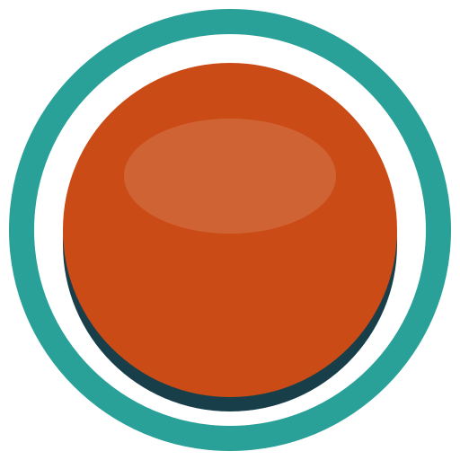

# The lazyOS brand

**lazyOS_** is a prompt waiting for you: the system has done the boring part, and the next key is
yours. The mark and the wordmark say the same thing - a lowercase `z` (lazy, and the sleep it stands
for) followed by the terminal cursor - and the tagline is the one the system has always had:
**lazy by design**.

Everything here is drawn in the session's own Solarized palette, so the brand never repaints the
desktop: it is the same cyan the bar, rofi and foot already use, plus one orange for the cursor.

## Files

| File | What it is | Rendered by `scripts/make-brand.sh` into |
|---|---|---|
| `lazyos.svg` | the mark, the source of truth | the icon theme's `48x48/apps/lazyos.png` and `scalable/apps/lazyos.svg` |
| `wallpaper.svg` | the default wallpaper, 1366x912 | `Pictures/Wallpapers/lazyos.png` |
| `social-preview.svg` | the repository's social card, 1280x640 | `brand/social-preview.png` |
| *(in the script)* | the mark as block characters | `~/.config/lazyos/wordmark.txt` (fastfetch), `~/.config/lazyos/screensaver.txt` (idle screen) |

The PNGs and the text art are committed, so a build host without `rsvg-convert` still builds an
image; only an edit to this directory needs the script. The landing page (`site/`) uses these files
directly: the Pages workflow copies `brand/` next to it.

## The mark

- A rounded **base02** tile, a **cyan** `z` and an **orange** cursor block, in that order. Rectangles
  and one polygon, no text, so `rsvg-convert`, librsvg and browsers all draw the same thing.
- Minimum size **16 px**. At 16 and 24 px the `z` and the cursor are still legible; nothing smaller
  is shipped.
- Don't recolour it, outline it, add a gradient or a shadow, or put the cursor anywhere but after the
  `z`. On a light background, keep the tile: the tile is what carries the mark onto any surface.

## The wordmark

- **`lazyOS_`**: `lazy` lowercase, `OS` capital, and the trailing underscore is the cursor, always
  orange. Set in **JetBrains Mono ExtraBold** with tight tracking (about -0.05em).
- In running text the name is **LazyOS** (no underscore, no colour). Identifiers stay `lazyos`
  (`org.lazyos.*`, `~/.config/lazyos/`, `ID=lazyos`).
- In a terminal, the wordmark is plain text `lazyOS_`; the picture is the block-character `z_` from
  `make-brand.sh`.

## Palette

The session's Solarized, with one adjustment for type.

| Role | Name | Hex | Notes |
|---|---|---|---|
| Background | base03 | `#002b36` | every surface |
| Surface | base02 | `#073642` | the tile, panels, cards, keys |
| Accent | cyan | `#2aa198` | the `z`, links, keys, the session accent |
| Cursor | cursor orange | `#e8743b` | the cursor, the wordmark's underscore. 4.8:1 on base03, so usable for text |
| Text | base2 | `#eee8d5` | headings, the wordmark |
| Secondary text | base1 | `#93a1a1` | captions, the arcade line |
| Solarized orange | orange | `#cb4b16` | the terminal palette's orange; 2.6:1 on base03, so never for text on its own |

## Type

**JetBrains Mono** everywhere (Regular, Bold, ExtraBold for the wordmark). It already ships in the
image (`fonts-jetbrains-mono`), and a monospace face is the brand: the prompt, the terminal, the
keyboard.

## Voice

Short, dry, keyboard-first. Say what the machine did and what key comes next.

- "lazy by design"
- "» press any key to continue «"
- "`$ lazyos --do-the-boring-part` → done. go outside."

## Not the brand

- The lock screen keeps the mountain photograph on purpose: the desktop is the surface the brand
  owns, and the photograph is what is up when nobody is looking (`AGENTS.md`).
- The old arcade-button mark and the ANSI Shadow `LAZYOS` letters are retired; `docs/plan-rebrand.md`
  is the history of the rename and still describes them.
