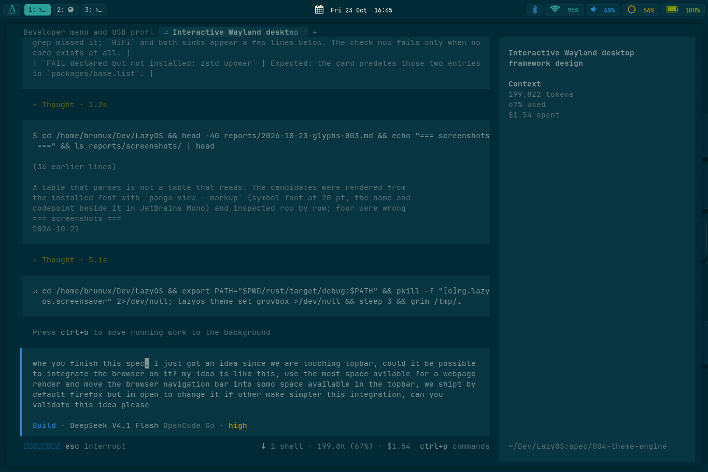
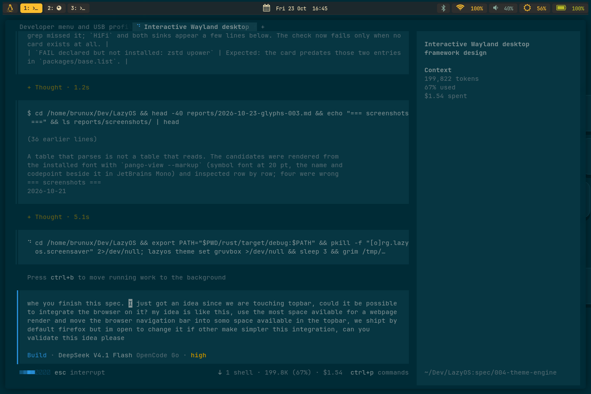

# 2026-10-23 - spec 004, the theme engine

Run on the Hayato, on the live session, because the engine's whole claim is
about files that a running session reads: whether `foot` accepts its generated
`foot.ini`, whether `waybar` accepts its generated stylesheet, whether the bar
and the wallpaper actually repaint on a switch. None of that can be answered in
a chroot.

## What was exercised

`specs/004-theme-engine.md` - `theme.toml`, the eight built-ins, the contrast
floor, the eleven generated surfaces, the atomic/idempotent writer, the
`lazyos theme` command, the two cycle keys and the four witnesses.

## The eight palettes and the floor they clear

The engine refuses a palette whose text is below 4.5:1 or whose signal roles are
below 3:1 against the theme's own background. Measured by the same code that
enforces it (`crate::contrast::ratio`, the WCAG formula):

| theme | slug | text | accent | danger | warn | ok | info |
|---|---|---|---|---|---|---|---|
| Catppuccin Mocha | `catppuccin` | 11.3 | 8.1 | 7.1 | 12.9 | 11.0 | 7.8 |
| Everforest Dark | `everforest` | 7.4 | 6.2 | 4.5 | 6.8 | 6.2 | 5.7 |
| Gruvbox Dark | `gruvbox` | 10.7 | 8.7 | 4.3 | 8.7 | 7.1 | 5.5 |
| Kanagawa | `kanagawa` | 11.3 | 5.9 | 5.1 | 9.7 | 7.5 | 5.9 |
| Nord | `nord` | 9.2 | 6.2 | 3.1 | 8.0 | 6.1 | 4.6 |
| Rose Pine | `rose-pine` | 13.4 | 8.4 | 6.1 | 10.8 | 10.4 | 10.4 |
| Solarized Dark | `solarized` | 5.6 | 4.8 | 3.2 | 4.7 | 4.7 | 4.1 |
| Tokyo Night | `tokyo-night` | 10.6 | 6.8 | 6.5 | 8.5 | 9.4 | 6.8 |

Two of them needed explicit roles to get there, and both are recorded in their
own files: **Gruvbox's regular red is 2.4:1** against its background (a mood,
not a warning), so its `danger` names the bright pair; **Kanagawa's regular red
is 2.7:1**, same fix. **Nord's danger clears the floor by 0.1** (3.1:1) - the
number is in the table because it is the one a future edit could push under.

## Every surface was validated with its own parser

A generated file that parses is not a generated file that works, so each one was
handed to the program that reads it:

| surface | check | result |
|---|---|---|
| `foot/foot.ini` | `foot --check-config -c <file>` | exit 0 |
| `mako/config` | `mako -c <file>` | `Failed to acquire service name: File exists` (the valid-file answer) |
| `waybar/style.css` | `waybar -c ... -s ...` in the foreground | `Bar configured (width: 1354, height: 30) for output: eDP-1`, no CSS error |
| `rofi/solarized.rasi` | `rofi -dump-theme -theme <file>` | parses; a negative control with a `#` header prints `Failed to parse theme` |
| `nvim/colors/lazyos.vim` | `nvim --headless -c 'source <file>'` | `g:colors_name` is `lazyos` |
| `starship.toml` | `STARSHIP_CONFIG=<file> starship print-config` | exit 0 |
| `sway/config.d/35-theme.conf` | `sway -C` over the whole configuration | exit 0 |
| `btop`, `lazygit`, `fzf`, `swaylock` | read back as text (no headless validator in the package) | golden files in the crate's tests |

## Two bugs the live run found

**The generated header was not a comment in every language.** `#` is a comment
in `foot.ini`, `mako`, `starship.toml` and a sway config, but it is an *id
selector* in GTK CSS and not a comment in rasi. On the first real switch:

```
[error] style.css:1:15Invalid name of pseudo-class    (waybar exited)
Rofi-WARNING: Failed to parse theme: ".../solarized.rasi"
```

`{{ header:/* }}` now writes a block comment for those two, and
`tests/surfaces.rs` pins the opener per file type (`/*` for css/rasi, `"` for
vim, `#` everywhere else), so the bug cannot come back silently.

**`check-system.sh` asked the wrong question twice.** `lazyos theme diff --quiet`
printed its `ok` line even in quiet mode, so the check read a success as a
difference; and it looked for the two bindings only in `/etc/sway/config.d/`,
where the drop-in this device had not yet received lives. Both fixed: the check
now reads the exit status, and the bindings were installed on this card
(`/etc/sway/config.d/33-theme.conf`) and the session reloaded.

## The round trip, on the live session

```
$ lazyos theme set gruvbox
gruvbox	Gruvbox Dark	11 written, 0 unchanged
$ grep -m1 'background: rgba' ~/.config/waybar/style.css
    background: rgba(40, 40, 40, 0.71);
$ lazyos theme set solarized
solarized	Solarized Dark	11 written, 0 unchanged
$ lazyos theme diff
ok	solarized	11 surfaces
$ diff uis/sway/files/home/.config/waybar/style.css ~/.config/waybar/style.css
$ diff uis/sway/files/home/.config/foot/foot.ini ~/.config/foot/foot.ini
```

Both `diff`s were empty: the live files are byte-identical to the renders
committed in the image. `waybar` and `mako` stayed up across both switches, the
bar repainted, and the wallpaper drop-in drew the picture (screenshots below).

| |
|---|
|  |
|  |

## `check-system.sh` - the theme section, verbatim

```
==> The theme engine
  OK    the active theme is solarized (Solarized Dark)
  OK    every surface is generated and carries the theme header
  OK    every surface is byte-identical to a fresh render
  OK    every built-in theme parses and clears its contrast floor
  OK    the binding for `lazyos theme next` is present
  OK    the binding for `lazyos theme wallpaper next` is present
```

The report this was cut from (`263 OK, 6 WARN, 17 FAIL`) is **not** committed:
the card this device boots predates the translate, wayvnc, agents, iproute2 and
framework work, so its 17 FAILs are the repo-vs-card drift already tracked in
`docs/test-checklist.md`, and none of them is in the theme section. A fresh card
is what a full report should be captured from.

## What a switch does not do

A terminal that is already open keeps its palette: foot reads its configuration
when a window is created. That is documented in `04-software.md` § Themes rather
than worked around, because the alternative - killing foot windows on a theme
switch - loses the user's shell.
