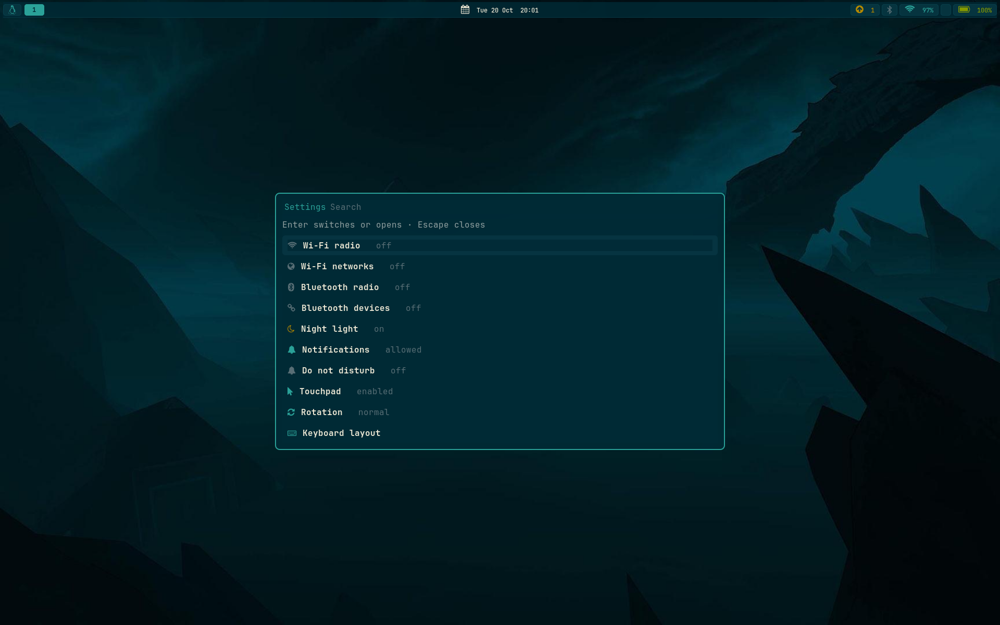
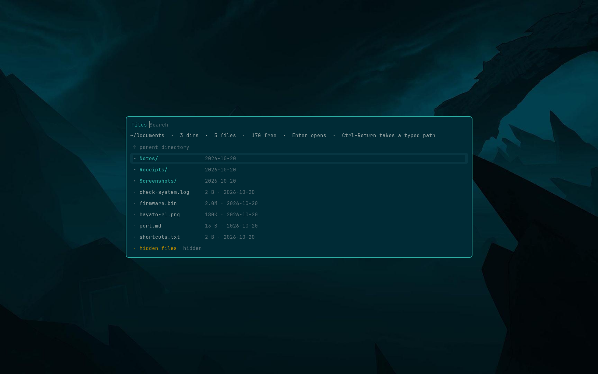
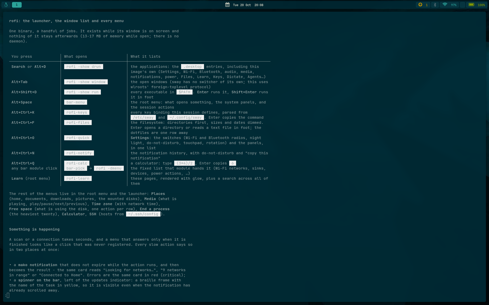

# uis/sway — Sway desktop

A UI is a package list plus a file tree:

```
uis/sway/
  packages.list          packages to install (Debian names)
  files/                 tree overlaid onto the rootfs
    etc/...              copied to /            (owned by root)
    home/...             merged into /home/$USERNAME (owned by the user)
```

`scripts/build-rootfs.sh` stages both into the chroot and
`scripts/rootfs-setup.sh` installs them, rewriting `/home/brunux` to the
configured `USERNAME` inside the text files.

This desktop was ported from the maintainer's Nura (postmarketOS) session, so it
keeps the solarized theme, the `Alt` modifier + Search-key launcher, the rofi
launcher, waybar and the foot terminal.

## Layout

| Path | What it is |
|---|---|
| `etc/sway/config` | System half of the session (replaces Debian's default file). Includes `config.d/*` at the end. |
| `etc/sway/config.d/*` | Drop-ins: logo key, bar, launcher, brightness, waybar, notifications, lock, volume, sleep, gestures, screenshots, theme, touchpad, bar panels, swayfx effects, idle screensaver. |
| `home/.config/sway/config` | Personal overlay: re-includes `/etc/sway/config`, then adds the keyboard repeat rate and the Search-key launcher binding. |
| `home/.config/waybar/{config.jsonc,style.css}` | Solarized waybar theme and the bar itself (see **The bar** below). |
| `home/.config/bin/rofi-learn` | **Learn**: the manual, one page at a time. |
| `home/.config/bin/rofi-keys` | **Keybindings**: every binding, parsed from the configuration. |
| `home/.config/bin/dictate`, `dictate-model` | Dictation with whisper.cpp; the model is fetched (pinned SHA256) on first use. |
| `home/.config/bin/sway-hibernate` | Hibernate, gated on a disk swap and `resume=`. |
| `home/.config/bin/rofi-agents` | **Agents**: launch a coding agent, install one, keep accounts per agent. |
| `home/.config/bin/rofi-capture`, `rofi-qr` | **Capture** (screenshot, annotate, OCR, QR, record) and the Wi-Fi QR code. |
| `home/.config/bin/rofi-power` | **Power** menu: lock, suspend, hibernate, log out, reboot, shut down (the last three ask first). |
| `usr/share/doc/nureb/*.md` | The seven manual pages the Learn menu opens. |
| `home/.config/rofi/config.rasi` | Launcher settings: the three modes, `terminal = foot`, matching. |
| `home/.config/rofi/solarized.rasi` | The solarized look, shared by the launcher, the window switcher and the bar's dmenu. |
| `home/.config/foot/foot.ini` | Solarized palette, JetBrains Mono and the Nerd Font fallback for the session terminal and the bar's popups. |
| `home/.bashrc` | The interactive shell: `ls` is eza, `cat` is bat, `cd` is zoxide, fzf key bindings and the starship prompt (see **The CLI tools**). |
| `home/.config/starship.toml` | Deboma's prompt: directory and git state in the theme's cyan. |
| `etc/profile.d/90-cli-tools.sh` | The CLI environment (`MANPAGER`, `BAT_THEME`, `PATH`), shared by login shells and `~/.bashrc`. |
| `etc/yt-dlp.conf` | Names Node as yt-dlp's JS runtime (see **The CLI tools**). |
| `home/.config/foot/screensaver.ini` | The idle screensaver's terminal: black, no padding, 26 pt. |
| `home/.config/mako/config` | Solarized theme for the notification daemon (`mako-notifier`). |
| `home/.config/nureb/screensaver.txt` | The logo the idle screensaver animates and then leaves on screen. |
| `home/.config/bin/sway-screensaver` | Launches the idle screensaver and is also the program that runs inside it (see **The idle screen**). |
| `home/.config/bin/bar-*` | The menus the bar opens on click: `bar-menu`, `bar-net`, `bar-bt`, `bar-key`, `bar-audio`, `bar-updates`, `bar-power`, plus the shared `bar-pick`. |
| `home/.config/workstyle/config.toml` | Icon map for workstyle (see below). |
| `home/Pictures/Wallpapers/mountains.jpg` | Wallpaper referenced by `etc/sway/config`. |
| `etc/keyd/default.conf` | Chromebook keymap for keyd: F-keys and VT switching (see below). |
| `etc/udev/rules.d/90-brightnessctl.rules` | Gives the `video` group write access to the backlight, so `brightnessctl` works for the unprivileged session (see below). |

## The compositor

The session runs **swayfx**, the wlroots fork that draws the effects Deboma gets from Hyprland:
rounded corners, shadows under windows, and a blurred backdrop under the three translucent
surfaces (the terminal, the launcher and the bar). Debian only packages
plain sway, so both the fork and its effects library are built from source
(`compositors/swayfx/`, `scripts/build-swayfx.sh`) and installed as `swayfx` + `libscenefx-0.5`,
which replace Debian's `sway` package. That is why `packages.list` does not mention `sway`: the
binary, `/etc/sway` and the greeter's `sway` command are the same either way, but
`scripts/install-swayfx.sh` has to put the fork in place.

`etc/sway/config.d/26-swayfx.conf` enables the effects and tunes the one that is not free:

| Effect | State | Why |
|---|---|---|
| `corner_radius 6` + `smart_corner_radius` | on | The corner is cut out of the window's buffer when it is committed; with the 8 px inner gap the radius is visible and nothing is done per frame. |
| `shadows` | on | One blurred texture per window, drawn once per frame. |
| `default_dim_inactive 0.0` | off | The solarized palette already dims unfocused borders; dimming a terminal turns its text grey. |
| `blur` | on | A tiled window samples a buffer blurred once from the wallpaper (one bilinear tap, 0.07-0.11 ms full screen); a floating window, and any window for the duration of its animation, is re-blurred live from what is behind it (2.1-2.2 ms, scaling with its area). |
| `blur_xray` | off | On, every surface would sample the cached wallpaper, including a floating window - cheapest, but the wallpaper shows through it instead of the window behind. |
| `blur_passes 2` / `blur_radius 4` | | A 32 px sample instead of the shipped 80 px, and the distance a live blur grows its damage by. |
| `blur_noise 0`, neutral brightness/contrast/saturation | | SceneFX skips its second full-screen pass when nothing is tinted; noise would also be visible grain. |
| `animation_duration_ms 150` | on | The only animation knob swayfx 0.6 has (no per-event directives, one fixed ease-out-cubic): open/close, tiling moves and the workspace cross-fade, ~9 frames at 60 Hz. It sends each animating window down the live blur path for that duration. |
| `layer_effects` | bar + launcher | The bar only has the wallpaper behind it and takes the cached path; rofi floats over windows and takes the live one. |

Blur is drawn *behind* a surface, so it only exists under one with alpha < 1: the terminal
(`foot.ini`, `alpha=0.92`), the launcher (`solarized.rasi`, 0.88) and the bar (`style.css`, 0.78 for
the bar and 0.86 for its cards) are the three carriers. `docs/optimization.md` §7 has the
measurements, the method, and why the renderer question has only one answer here.

The drop-in is swayfx-only, so `sway -C` failing means Debian's plain sway is installed again
(`scripts/check-system.sh` fails on that, and on a `sway --version` that does not say `swayfx`).

## The launcher

Three jobs, one binary: **rofi** 2.0, themed by `~/.config/rofi/config.rasi` (settings) and
`~/.config/rofi/solarized.rasi` (the look).

| Binding | Command | What it lists |
|---|---|---|
| Search key, `$mod+d` | `rofi -show drun` | the `.desktop` entries, including the port's own session actions in `usr/share/applications/org.nureb.*` |
| `$mod+Tab` | `rofi -show window` | the open windows, through wlroots' `zwlr_foreign_toplevel_manager_v1` - sway has no switcher of its own |
| `$mod+Shift+d` | `rofi -show run` | every executable in `$PATH`; **Enter** runs it, **Shift+Enter** runs it in foot, which is how the TUIs from `packages/tools.list` are started |
| any bar panel | `bar-pick` → `rofi -dmenu` | the fixed list the bar hands it |

It replaces **tofi** (launcher) and **fuzzel** (bar popups), so the session runs one picker
instead of two. Measured on this machine, per process, in the same headless compositor the bar
was measured in:

| Launcher | PSS while open | Notes |
|---|---|---|
| **rofi**, drun, this theme | **15.7-17.1 MB** | text only |
| rofi, drun, **icons on**, ten rows | **13.2 MB** | measured again with the Nureb icon theme: only the visible rows are decoded, and the 57 MB figure came from a run that decoded far more |
| rofi, `-dmenu` (a bar click) | 14.2-15.6 MB | |
| rofi, `-show window` | 16.7 MB | |
| tofi, drun (before) | 14.6 MB | applications only; its run mode just printed the selection |
| fuzzel, `--dmenu` (before) | 40.5 MB | what every bar click cost |
| wofi, drun | 62.1 MB | |
| walker / Wox | resident | a GTK4 service / a ~150 MB daemon |

None of these is a daemon: rofi exists while its window is on screen and nothing stays
afterwards. rofi 2.0 speaks Wayland natively - it is a layer-shell client, and the window
mode uses the foreign-toplevel protocol - so no Xwayland is involved, even though the
package still supports X11.

The theme is the session palette: base03 window, a 2 px cyan rim, JetBrains Mono 12, the
prompt in cyan, entries in base1, the typed text in base2, and the selected row a base02
card with 6 px corners. The layout drops what rofi shows by default and this session does
not need (mode switcher, message bar, counter) and the box shrinks to the number of
entries it has, up to ten, so a three-item bar menu and the eight-application list both
get a box that fits them. Matching is fzf-style fuzzy.

**Icons: font glyphs in the lists, images in the launcher.** Every list this port draws itself
puts a Font Awesome codepoint in the row text (`~/.config/bin/lib-rofi.sh`), the same alphabet
the bar uses: it costs nothing, follows the palette and is filtered away by typing. The
launcher and the window switcher show the application's real icon, which rofi resolves through
glycin - about 13 MB while ten rows are on screen and nothing afterwards, with `bubblewrap` in
`uis/sway/packages.list` so glycin can sandbox the decoder.

Debian's Adwaita 51 ships only monochrome *symbolic* icons and not one of this session's
names - a drun row for "Files" had a hole where its icon should be - and the one full-colour
theme in the archive (`papirus-icon-theme`) is 190 MB installed. So `scripts/make-icons.sh`
renders the same Font Awesome codepoints into 48x48 PNGs and they ship as a small **Nureb**
icon theme (`usr/share/icons/Nureb`), whose `index.theme` inherits Adwaita and hicolor: an
application that brings its own icon (foot, btop, htop, anything installed later) still shows
it in colour. The bar's popups pass `-no-show-icons` because they draw their own glyph.

The command palette needed the same treatment for a reason that is not obvious: rofi's **run**
mode asks the icon theme for an icon *named after the binary* it would run
(`rofi_icon_fetcher_query(str[0], …)`), not for a `.desktop` icon, so without an icon called
`foot.png` a palette row has a blank 26 px column. `make-icons.sh` therefore renders a second
table under those names, and the fixed column keeps the rows without one aligned.
`check-system.sh` warns (never fails) when they are missing.

That was measured, not assumed: the first attempt at this theme shipped SVGs with a literal
private-use character, which does not survive every editor or transport, and the first
`make-icons.sh` ran `printf` under dash, which has no `\u` escape - both produced a row of
empty spans, which is what the check for an empty canvas in the script now prevents. The theme also
has to offer the icons through a *scalable* directory: a theme that shipped only `26x26` resolved
nothing in rofi, while `48x48` plus a scalable entry does.


Two behaviours were verified rather than assumed: `rofi -dmenu` exits 1 on Escape, which is
what `bar-pick`'s callers' `|| exit 0` relies on, and drun honours `Terminal=true` through
the `terminal` setting (`foot`) - run mode needs Shift+Enter for that, rofi's own "run in
terminal" binding.

To check the theme after an edit, run `rofi -show drun` in the session: a parse error is a
dialog naming the file, line and column. `rofi -dump-config` does **not** report theme parse
errors.

## The menus

Everything that is not the launcher or a bar panel is a `rofi-*` script in
`~/.config/bin/`, built on three helpers in `lib-rofi.sh` (`ui_row` for the one row style,
`ui_pick` for the table-and-key round trip, `ui_say` for the result):

| Script | Key / entry | What it does |
|---|---|---|
| `rofi-quick` | `Alt+Ctrl+O`, Settings | the switches of the session in one list: Wi-Fi and Bluetooth radios (with the pickers one row below), night light, do-not-disturb, touchpad, rotation, keyboard layout, audio, media, battery. It redraws after every switch, so the state it shows is never stale, and its probes run in parallel (two `bluetoothctl` clients, `nmcli` and `swaymsg` in sequence made it feel broken) |
| `rofi-power` | `Alt+Escape`, `Alt+Ctrl+P`, Power menu | lock, suspend, hibernate, log out, reboot, shut down; the last three ask once more through `bar-pick` |
| `rofi-notify` | `Alt+Ctrl+N`, Notifications | mako's history (`makoctl history -j`), Enter copies one, plus restore, dismiss-all and do-not-disturb |
| `rofi-clean` | Free space | `df` plus what grows (trash, thumbnails, apt cache, journal, `~/.cache`), one action per row, re-measured afterwards |
| `rofi-kill` | End a process | the heaviest twenty by resident memory; SIGTERM, then an explicit offer of SIGKILL |
| `rofi-tz` | Time zone | `timedatectl list-timezones` with the current one marked, and the network-clock switch. It restarts waybar afterwards: `timedatectl` only rewrites `/etc/localtime`, and a running process keeps the zone glibc cached the first time it called `localtime()` |
| `rofi-places` | Places | home, documents, downloads, pictures, the mounted filesystems; Enter browses there with `rofi-files` |
| `rofi-media` | Media | the current track and play/pause/next/previous through `playerctl` |
| `rofi-calc` | `Alt+Ctrl+Q`, Calculator | awk, one prompt; Enter copies the result |
| `rofi-layout` | Settings → Keyboard layout | every layout in `evdev.lst`, applied to all keyboards and kept in `~/.config/sway/config.d/90-keyboard-layout.conf` |
| `rofi-emoji` | `Alt+Ctrl+E`, Emoji | the table `scripts/make-emojis.sh` generates (`~/.config/emojis.tsv`, ~2000 rows); Enter inserts at the cursor, Alt+1 copies only |
| `rofi-clip` | `Alt+Ctrl+V`, Clipboard | the `cliphist` history: Enter copies an entry back, Alt+1 deletes it, plus "save the newest image" and "clear the history" |
| `rofi-dns` | DNS | the resolver of the connection that is up: Cloudflare, Google, Quad9, AdGuard, typed servers, or back to DHCP |
| `rofi-pkg` | Packages | `apt-cache search`, then `apt-get install -y` behind a busy card; installed packages are marked before they are picked |
| `rofi-color` | Colour | a pixel (`slurp -p` + `grim` + `ffmpeg`), and the sixteen solarized colours as swatch rows |
| `rofi-remind` | Reminders | transient `systemd-run --user --on-active=` timers, listed back from systemd, cancelled by choosing one |
| `rofi-about` | About | model, revision, kernel, uptime, memory, disk, battery, network, compositor, processes |
| `rofi-learn` | Learn | the manual, rendered with glow, with a search across every page |
| `rofi-files`, `rofi-keys`, `rofi-agents` | see below | the file browser, the key view, the agents menu |



Each one is a single process while its window is open and nothing afterwards. They all end in
`ui_pick` (`ui_pick_alt` when a second action sits on Alt+1), which is `bar-pick` (rofi's dmenu)
over a table: rofi hands back the *rendered* row, so the key of the chosen row travels in a second
column that markup cannot be parsed out of.

## Clipboard history and emoji

These two are the batch that took the session its only resident process and its first generated
data file, and both are worth the exception:

* **`rofi-clip`** (`Alt+Ctrl+V`) is a list over `cliphist`, which is fed by
  `wl-paste --watch cliphist store` (one `exec` line in
  `etc/sway/config.d/27-clipboard.conf`). About 2 MB, and there is no history without it:
  `wl-clipboard` alone only knows the current selection. Rows are classified as text, link or
  image from what `cliphist` keeps; an image is listed by its size and dimensions, not by a
  thumbnail, because a rofi row is one line. "Save the newest image" decodes it into
  `~/Pictures/clipboard/` with the extension its MIME type implies and opens it. The database is
  `~/.cache/cliphist/db` and holds everything copied, secrets included; the menu's last row
  clears it.
* **`rofi-emoji`** (`Alt+Ctrl+E`) reads `~/.config/emojis.tsv`, which `scripts/make-emojis.sh`
  generates on the build host from Python's Unicode database (name, glyph, block: 1988 rows, the
  emoji blocks of the standard plus Dingbats and Miscellaneous Symbols). The image needs neither
  Python nor a package for it — the file is committed and copied with the home directory. Insertion
  is Omarchy's: the glyph goes to the clipboard and `wtype -M shift -k Insert -m shift` types a
  virtual Shift+Insert, which every toolkit here understands as paste; `wtype -t "$glyph"` would
  need a keysym for the codepoint, which most emoji do not have. Alt+1 is the clipboard write
  alone. `fonts-noto-color-emoji` draws the glyph, and `check-system.sh` asks `fc-match emoji`.

The other five lists (`rofi-dns`, `rofi-pkg`, `rofi-color`, `rofi-remind`, `rofi-about`) are plain
scripts with no such trade-off: DNS is two `nmcli` properties plus a re-activation, packages are
`apt-cache`/`apt-get` behind the busy card, colour is `slurp` + `grim` + `ffmpeg -f rawvideo`
(no ImageMagick), reminders are transient timers that fire `notify-send` once, and about reads
procfs and sysfs.

## Something is happening

A scan or a connection takes seconds; a menu that answers only when it is done reads as a
click that was never registered. `~/.config/bin/busy` is the one place that says otherwise, and
it says it twice:

* a **mako toast** that does not expire while the action runs and then *becomes* the result -
  the same card reads "Looking for networks…", "9 networks in range", "Connected to Home", or
  the error in red. Every message carries the same `x-canonical-private-synchronous` tag, so
  mako replaces the card instead of stacking one per step;
* a **spinner on the bar** (`custom/busy` → `bar-busy`), a braille frame with the task name in
  yellow, left of the updates indicator.

`busy start|update|stop|end|fail TAG LABEL MESSAGE [ICON]` writes one file per task in
`$XDG_RUNTIME_DIR/nureb-busy` and signals waybar (signal 8, the same mechanism the other `bar-*`
modules use). `bar-busy` prints `{"class":"empty"}` when there is nothing to show, which
`style.css` collapses to zero width, and it drops a state file older than five minutes so a
script killed mid-action cannot leave a spinner on the bar forever.


Wired into: the Wi-Fi rescan, connect, disconnect and radio switch; the Bluetooth scan (three
seconds), connect, disconnect and radio; the `du` walk in Free space. Two lines per action:

```sh
busy start wifi Wi-Fi 'Looking for networks…' network-wireless
scan=$(nmcli --terse --fields IN-USE,SSID,SECURITY,SIGNAL device wifi list --rescan yes)
busy stop wifi
```

## The file browser

`rofi-files` (`Alt+Ctrl+F`, "Files" in the root menu and the launcher) exists because rofi 2.0
has no `filebrowser` mode - its modes are `drun`, `run`, `window` and `ssh`. It is a shell script
around `rofi -dmenu`:

* the rows are Pango markup, directories first (cyan, trailing `/`), then files with the size
  and the date dimmed; `find -L` decides the type, so a symlink to a directory navigates and a
  broken link says so;
* the name column is padded to the longest name in the listing, which works because the theme
  is monospace, and dmenu matches the text **with the markup stripped** (verified: a filter on
  a tag name finds no row), so typing a name is not disturbed by the styling;
* Enter opens a directory, reads a text file with `bat --paging=always` (`BAT_THEME=ansi`) inside
  the floated `popup` foot window, and hands everything else to **firefox-esr** - an image, a
  PDF, an SVG, the HTML file. The first 4 kB are checked for a NUL to tell the two apart, because
  bat would show a binary as an empty page. Firefox is the only viewer the image carries: it
  renders its own PDFs, costs 280 MB of disk once, and nothing while it is closed;
* `↑ parent directory` is the first row (and the one that is *not* preselected), the dotfiles
  are toggled by the last row, and a typed path that matches nothing is taken literally, which is
  what makes Ctrl+Return useful;
* the line under the prompt carries the path, the counts and the free space.

Nothing is cached or resident: the listing is built per run, and the viewer is foot's or
Firefox's own window. `check-system.sh` fails when the script or the browser is missing, because
Alt+Ctrl+F and the menu entry would silently do nothing (or answer "no browser is installed").

`usr/local/bin/xdg-open` is two dozen lines around the same binary: a URL goes to Firefox as it
is and a path becomes a `file://` URL, which is what foot's ctrl+click, `yt-dlp --print-trailer`
and any script that shells out to `xdg-open` expect. There is no desktop portal in this image.



## The key scheme

The session speaks Omarchy's keys with `Alt` in place of `Super`, so an action keeps the
same letter and the same Ctrl/Shift combination wherever a sway default does not already
own it. The whole set is the *Shortcuts* page of the manual
(`usr/share/doc/nureb/03-shortcuts.md`) and, generated from the configuration,
`rofi-keys`; this is the shape of it:

| Group | Keys | Where it lives |
|---|---|---|
| launcher, switcher, commands | `Search`/`Alt+D`, `Alt+Tab`, `Alt+Shift+D` | `19-launcher.conf` |
| root menu | `Alt+Space` (Omarchy: `Super+Space`) | `24-keys.conf` |
| panels | `Alt+Ctrl+A/B/W` → audio, Bluetooth, network (Omarchy: `Super+Ctrl+A/B/W`) | `24-keys.conf` |
| system | `Alt+Escape` and `Alt+Ctrl+P` power menu (`rofi-power`), `Alt+Ctrl+L` lock, `Alt+Shift+Escape` lock+sleep, `Alt+Ctrl+Escape` sleep | `21-lock-screen.conf`, `22-sleep.conf`, `24-keys.conf` |
| browser | `Alt+Shift+Return` opens `firefox-esr` | `19-launcher.conf` |
| windows | `Alt+Q` close, `Alt+T` float, `Alt+F` fullscreen, `Alt+grave` scratchpad, `Alt+R` resize | `config`, `24-keys.conf` |
| views | `Alt+Ctrl+K` every binding, `Alt+Ctrl+X` dictation, `Alt+Ctrl+Shift+A` agents | `24-keys.conf` |
| files | `Alt+Ctrl+F` (`rofi-files`) | `24-keys.conf` |

The three places where the letter differs are deviations with a reason, and each is written
next to the binding: close is `Alt+Q` because `Alt+W` is sway's tabbed layout, the key view is
`Alt+Ctrl+K` because `Alt+K` is vim focus up and `Alt+Shift+K` moves the window, and there is no "cycle layout" key because
sway's layouts are stacking/tabbed/split rather than Hyprland's dwindle/master/scrolling.
The panel keys run the very scripts the bar's indicators run (`bar-audio`, `bar-bt`,
`bar-net`), so a panel has one implementation and two ways to reach it. The power menu is the
one exception: the key opens `rofi-power` (actions, and a yes/no on the three that cannot be
undone) while the bar's battery indicator still opens `bar-power` (numbers), because those are
two different questions and one script answering the wrong one is what made both keys look dead.


**Every binding carries its description on a comment line above**, and the description
covers the bindings below it until a blank line or another comment, because `rofi-keys` reads
those comments as the text it shows; a binding without one appears as its raw command in the
key view. The `Alt+minus`/`Alt+Shift+minus` pair stays as the sway-default alias of the two
scratchpad actions, and sway's `focus mode_toggle` was dropped from `Alt+Space` in favour of
the menu (floating itself is still `Alt+Shift+Space`).

## The manual, the key view, dictation and hibernate

Four features that exist because rofi and the terminal can carry them without a resident process;
`usr/share/doc/nureb/` holds the manual they are documented in.

**Learn** (`Alt+Space` root menu → Learn, or the launcher entry) lists the pages in
`/usr/share/doc/nureb/` and opens the chosen one with **glow** inside foot, so the markdown is
*rendered* (headings, tables, inline code, lists) instead of shown as source, in the palette of
`~/.config/glow/solarized.json`. The first row is a search: ripgrep over every page, one row per
match, Enter opens the page that contains it. There is no browser in the image, and a terminal page
costs 25 MB while it is open.



`glow` is `packages/tools.list` (a single binary, no runtime); its style is a glamour description,
which is why it lives next to `glow.yml` and not in the rofi theme - the two formats are unrelated.
`glow.yml` has to name the style by **absolute path**: a bare name is looked up among glow's
built-ins, and `-s solarized` fails with *specified style does not exist*.

**Keybindings** (`Alt+Ctrl+K`, matching Omarchy's `Super+K`) is generated, not written: `rofi-keys`
parses every `bindsym`/`bindcode`/`bindswitch`/`bindgesture` line from `/etc/sway/config`,
`/etc/sway/config.d/*.conf` and `~/.config/sway/config`, expands the `set $var` definitions, and
uses the comment above each binding as its description (the files are written that way). It is shown
with `rofi -dmenu -markup-rows`, so keys are bold and descriptions are dim; Enter copies the command
to the clipboard. A binding added anywhere shows up on the next run, which is the point: a separate
list would drift the first time someone edits the configuration.

**Dictation** (`Alt+Ctrl+X`, matching Omarchy's `Super+Ctrl+X`) is `parecord` at 16 kHz mono while
it records, then `whisper-cli` for the transcription, then `wtype` into the focused window (and the
clipboard as a fallback). The level is normalised with `ffmpeg -af dynaudnorm` before whisper: the
internal microphone records quietly and whisper is sensitive to that. The model is fetched on first
use by `dictate-model` - 78 MB for the
default `ggml-tiny.en.bin`, 148 MB for `base.en` - verified against a pinned SHA256 and kept in
`~/.local/share/whisper/`. Recording stops itself after 60 seconds and the state is a pid file in
`$XDG_RUNTIME_DIR`, so nothing survives a crash. Both silent phases report through `busy`: the
notification says it is recording ("Alt+Ctrl+X stops it"), becomes "Transcribing…" and ends as the
text it typed or the reason it failed, and the bar shows its spinner. Pressing the key again - or
the root menu's Dictation row - stops it (SIGINT, which is what finalises the wav). Omarchy uses
voxtype (a Rust daemon with a state file); this is the same interaction without the daemon.

**Agents** (`Alt+Ctrl+Shift+A`, Omarchy's `Super+Shift+Ctrl+A`) is `rofi-agents`: it lists the
coding-agent CLIs it knows (Claude Code, Codex, OpenCode, Gemini, Copilot), launches the installed
one in foot from `~/Work`, offers `npm install -g --prefix ~/.local <package>` for the rest (so npm
never wants root), and keeps **accounts** for the two that support an alternative config directory -
Claude Code (`CLAUDE_CONFIG_DIR`) and Codex (`CODEX_HOME`) - as one directory per account under
`~/.local/share/nureb/agents/`. Omarchy's usage meters are deliberately absent: they read provider
APIs that change shape, and a broken meter is worse than none; if they return, the fitting shape is a
`python3` script printing one line for a waybar `custom` module, not a daemon.

**Hibernate** is only offered when it can resume: `/sys/power/state` must contain `disk`, a swap on
disk (not zram) must be at least ~2/5 of RAM, and the kernel command line must carry `resume=`
(`resume=LABEL=nureb_swap`, resolved through udev, so a labelled SD swap partition is enough). Each
missing condition gets its own message; it never hibernates into a swap the machine cannot come back
from. There is no disk swap in the default image.

## The bar

The bar is the Deboma (Omarchy) bar, ported: the same left-to-right reading (menu, workspaces,
clock, **busy**, updates, tray, layout, bluetooth, network, volume, brightness, battery) and the same
interactions.  The busy card only exists while an action runs (see *Something is happening*); it is
one shell per second while it is on screen, and a zero-width module the rest of the time.  What differs is what happens on a click.  Deboma answers with a Quickshell panel, and
the shell process that draws those panels costs **361 MB** of PSS: more than half of the whole
Deboma session and several times a booted Nureb.  Here every click runs a short-lived process
instead, and nothing survives the click:

| Indicator | Left click | Right click | Scroll |
|---|---|---|---|
| menu | root menu (terminal, Wi-Fi, Bluetooth, audio output, dictation, capture, lock, suspend, the power menu) | terminal | – |
| workspaces | focus / move (sway) | – | disabled |
| clock | switch format (date + time / seconds) | – | previous / next month (hover shows the month grid) |
| updates | apt updater in a floating terminal (the module only exists while something is pending) | – | – |
| tray | application StatusNotifier items | – | – |
| layout | next xkb layout (the module hides itself when only one layout is configured) | – | – |
| bluetooth | device list from a 3 s scan; picking one connects it, picking a connected one disconnects it | `bluetoothctl` in a floating terminal | – |
| network | Wi-Fi list, strongest first, the active one marked `*`; a new secured network asks for its password in a masked prompt | `nmtui` in a floating terminal | – |
| volume | mute / unmute | output list (speakers, headphones, a Bluetooth headset): switches the default and moves the playing streams | volume, 5% steps |
| brightness | – | – | backlight, 5% steps |
| battery | power panel: charge, state, draw, time left, charger, uptime, memory, swap, kernel | root menu | – |

`rofi` in dmenu mode draws the menus - the same binary that is the launcher - `foot
--app-id=popup` (floated by `etc/sway/config.d/25-bar-panels.conf`) runs what needs a real
terminal, `nmtui` and `bluetoothctl`; `swaynag` shows the power panel.  All of those are already
in the image for other reasons, so the bar needed no package of its own once rofi replaced the
launcher.  The bar itself is the only resident process.

The scripts are POSIX `sh`, they live in `home/.config/bin/`, and they share `bar-pick`, which holds
the look of every popup through `~/.config/rofi/solarized.rasi`.  Each one
documents at the top of the file which Deboma widget it reproduces.  Icons are written in
`config.jsonc` as `\uXXXX` escapes so the codepoint is readable and survives any editor; they are
Font Awesome (see the font table below).

### Refreshing

waybar polls `custom` modules on an `interval`, so a click that changes something would stay
invisible until the next tick.  Every bar script therefore ends with `pkill -RTMIN+8 waybar` and
every `custom` module declares `"signal": 8`, so one signal re-runs all of them at once.  The
intervals are long on purpose (`bar-updates` every 6 hours, Bluetooth every 30 s, the layout every
10 s) to keep the fork count at zero in the steady state; the signal covers the interactive case.

Two modules collapse to zero width when they have nothing to say, using the CSS class the script
prints in its JSON (`"class": "empty"`, matched by `#custom-updates.empty` in `style.css`): no
upgrades pending, and a single keyboard layout.  Without that they would leave an empty card on the
bar.

### What was left out of the Deboma bar

* **weather**, **elsewhen** (time until the next calendar event), **indicators** and **agents**:
  none of them is a control, and each one is another process or network call.
* **workstyle** (workspace icons) is not packaged in Debian; see above.
* **Power profiles** in the power panel need `power-profiles-daemon`, a resident daemon and a
  D-Bus service for a setting that is not exposed through sysfs on this SoC.  The panel shows the
  readings instead; add the package to `packages.list` if the profiles matter more than the memory.
* **The calendar opens on hover, not on click.**  waybar's clock shows `{calendar}` in its
  tooltip, which costs no process; a click switches the clock format instead.
* **No CPU / memory / temperature / disk modules.**  The Deboma bar does not show them and this port
  follows that layout.  They are one line each in `config.jsonc` (plus their card in `style.css`)
  if they are wanted back.

`nmcli`, `bluetoothctl`, `pactl` and `brightnessctl` come with packages that were already listed
(`network-manager`, `bluez`, `pulseaudio-utils`); the additions are `rofi` (also the launcher and
the window switcher) and `jq` (which parses `swaymsg -t get_inputs` for the layout indicator).  `scripts/check-system.sh` verifies all of
it on the device: every bar script executable, those tools present, and the backlight device named
in `config.jsonc` existing under `/sys/class/backlight` (a wrong name leaves waybar's module empty
with no error anywhere).

## Notifications

Deboma's notifications are a Quickshell panel; here they are **mako** — the daemon sway starts from
`config.d/20-notifications.conf`, themed in `home/.config/mako/config` with the bar's palette (base03
background, base1 text, cyan border, 8 px radius, hanging 40 px from the top so it never covers the
30 px bar). `group-by=app-name` and `sort=-time` keep the stack readable, critical notifications stay
until dismissed and turn red, and icons are capped at 48 px.

Debian's package is **`mako-notifier`**, not `mako`: the name `mako` belongs to a Python template
library, while the binary is still `/usr/bin/mako`. The config parses with `mako -c <file>` — a bad
key prints `Failed to parse option '<key>'`, a good file goes on to fail on acquiring the bus name
when another daemon is already running.

`check-system.sh` asks the session bus for `org.freedesktop.Notifications`: a daemon that died
leaves every application's notifications silently lost, with nothing in the journal.

## The idle screen

Deboma runs a screensaver 150 s after the last input and locks at 300 s
(`shell.json`: `"idle": {"screensaver": 150, "lock": 300}`). The same chain runs here on `swayidle`
(`config.d/23-screensaver.conf`), with two differences, both about cost:

* **The effect plays once.** Deboma's `omarchy-screensaver` loops `ttfx` at 120 fps; measured here,
  that is 78 MB of Python plus a full 1920x1200 repaint 120 times a second on the Mali-G57, for as
  long as the screen is idle. `sway-screensaver` runs `tte` once, then prints the static logo and
  waits for one keypress: the effect keeps its (~10 s) animation, and what stays on screen is a
  single foot window, about 25 MB and no CPU. The animation is `tte`'s **stdout**: the first
  version sent it to `/dev/null` while silencing its log, so the screen stayed black and only the
  logo appeared ("nothing moves"). The effects are curated (`decrypt print sweep wipe slide`, the
  ones that end with the text in place) and the frame rate is 30, not 120.
* **No per-monitor launcher.** Deboma's launcher walks `hyprctl monitors`, opens a terminal per
  monitor in a special workspace and listens on Hyprland's socket; here the session has one output
  and the window rule in `23-screensaver.conf` fullscreens `[app_id="org.nureb.screensaver"]` on the
  current workspace.

Any key dismisses it and the next keypress goes to whatever is underneath. At 300 s `swayidle` kills
the screensaver *and* locks, so unlocking does not land back on a logo; `before-sleep` locks before a
suspend for the same reason. The bar menu has a **Screensaver** entry that starts it on demand.

The logo is `~/.config/nureb/screensaver.txt`, 7 rows of block art invented here (Deboma's is ASCII
art of the Omarchy mark), printed in solarized cyan at 26 pt.

## The CLI tools

Deboma ships an opinionated terminal and this port keeps it: the tools are listed in
`packages/tools.list` (a third list next to `packages/base.list` and `uis/sway/packages.list`,
installed by `rootfs-setup.sh`) and wired by two files — `etc/profile.d/90-cli-tools.sh` for the
environment and `home/.bashrc` for the interactive shell.

| Instead of | Tool | Notes |
|---|---|---|
| `ls` | **eza** | `ls -lh --group-directories-first --icons=auto`, plus `lsa`, `lt`, `lta`. |
| `cat` | **bat** | `--style=plain --paging=never`. Debian's binary is `batcat`; `rootfs-setup.sh` adds `/usr/local/bin/bat`. |
| `find` | **fd** | Debian's binary is `fdfind`, same symlink. It is also `FZF_DEFAULT_COMMAND`. |
| `grep` | **ripgrep** | Not aliased: `rg` is not a drop-in for every `grep` flag, and a quietly different grep is a trap. |
| `cd` | **zoxide** | A `cd` wrapper tries the real path first, so only non-paths jump by frecency. |
| the prompt | **starship** | Deboma's `starship.toml`, shipped as `~/.config/starship.toml`. |
| `top` | **btop** | |
| `man` pager | **bat** | `MANPAGER='sh -c "col -bx | bat -l man -p"'`; `bsdextrautils` supplies `col`, `man-db` supplies `man` itself. |

Also present: `fzf` (key bindings only — its completion wrappers cost ~25 ms per shell start), `tldr`
(`tealdeer`), `fastfetch`, `inxi`, `tmux`, `lazygit`, `gum`, `yt-dlp`, `ffmpeg`, `curl`, `unzip`,
`whois`, `socat`, `inotify-tools`, `qrencode`, `zbar-tools`, `tesseract-ocr` and `nodejs`/`npm`.

**`/etc/yt-dlp.conf` names Node as yt-dlp's JavaScript runtime.** yt-dlp 2026 needs one to solve
YouTube's JS challenges and enables only `deno` by default, which Debian does not ship, so a stock
install logs `JS runtimes: none` and warns that *some formats may be missing*. `nodejs` is already
installed (for npm), so the config only has to say `--js-runtimes node`. Verify with
`yt-dlp -v --simulate <url>`: the debug line becomes `JS runtimes: node-24.21.0`.

`ff` and `eff` are the fzf helpers: `ff` previews with bat, `eff` opens the pick. Nothing is a
service or a daemon — `plocate` is deliberately absent because it is `locate` *plus*
`plocate-updatedb.timer`, and `tree-sitter-cli`/`lua5.4`/`wtype`/`gawk` are absent because they only
feed Omarchy's own components, which this port does not have. The full rationale is in
`packages/tools.list`.

**The Nerd Font fallback has to be listed in `foot.ini`.** foot does not fall back through
fontconfig for a glyph its font lacks — it draws a box — so `font=` names `Symbols Nerd Font Mono`
after JetBrains Mono (`fonts-nerd-symbols`). That is what makes eza's icons, fastfetch's logo and
the starship git glyphs render. waybar needs no such line: it is a Pango program.

## Deviations from the Nura original

* **Fonts.** The theme asks for `AdwaitaMono Nerd Font` / `JetBrainsMono Nerd Font`, which Debian
  does not ship (its `fonts-adwaita` has no Mono variant), so `style.css` and the Pango spans in
  `config.jsonc` use `JetBrains Mono`. The icons come from fontconfig fallback and need two
  packages people usually miss:

  | Glyphs | Package |
  |---|---|
  | Font Awesome, `U+F000`-`U+F2FF` | `fonts-font-awesome-legacy` |
  | Material Design Icons, plane 15 | `fonts-materialdesignicons-legacy` |
  | Octicons, Codicons, Devicons, Powerline | `fonts-nerd-symbols` |

  `fonts-nerd-symbols` alone is not enough: Debian stripped Font Awesome and Material Design
  Icons from it for DFSG reasons, so every waybar icon would render as a tofu box with the hex
  codepoint inside. Nothing else in the configuration changes.
* **workstyle is not installed.** It is not packaged in Debian and the Nura
  build was a cargo binary linked against musl (it cannot run against glibc).
  It renames workspaces to icons; the waybar theme shows workspace numbers, so
  nothing is missing visually. `home/.config/workstyle/config.toml` is kept so
  that enabling it later needs no extra configuration:

  ```sh
  cargo install workstyle
  echo 'exec_always --no-startup-id workstyle' >/etc/sway/config.d/03-workstyle.conf
  ```

* **Bluetooth needs `bluez`, not just the PipeWire plugin.** `libspa-0.2-bluetooth` only gives
  PipeWire a D-Bus client for `org.bluez`; the daemon that actually powers the controller up
  (and provides `bluetoothctl`) is in `bluez`, which is now listed next to it in
  `packages.list` (see `AGENTS.md`).

* **ALSA-only programs need `pipewire-alsa`.** Debian's alsa-lib configuration has no usable
  `default` PCM by itself, so `aplay`/`arecord` without an explicit `-D`, emulators and some
  games fail with *audio open error: No such file or directory* even though PipeWire (and
  therefore PulseAudio clients) works. `pipewire-alsa` is listed in `packages.list`.

* `etc/sway/config.d/01-status-bar.conf` disables swaybar (waybar is used
  instead); the block is kept commented out for reference.

## Brightness, volume and lock keys

The top row is handled by sway: `XF86MonBrightness{Down,Up}` run `brightnessctl`
(`etc/sway/config.d/20-brightness.conf`), `XF86Audio{Raise,Lower}Volume` /
`XF86AudioMute` run `pactl` (`etc/sway/config.d/21-volume.conf`), and the Lock key locks
the screen (`etc/sway/config.d/21-lock-screen.conf`). Some of the pieces are
easy to miss:

* **Backlight permissions.** Debian's `brightnessctl` ships no udev rule and nothing
  else in the system touches `/sys/class/backlight`, so the brightness file stays
  root-only (0644) and `brightnessctl set` fails with *Permission denied* for the
  session user. `etc/udev/rules.d/90-brightnessctl.rules` puts it in the `video` group
  and makes it group-writable (this is the rule upstream brightnessctl installs).
* **A real audio sink.** `pactl` acts on `@DEFAULT_SINK@`. If the MT8192 card's UCM boot
  sequence has not run, the card exposes no sink and WirePlumber falls back to a *Dummy
  Output*, so the volume keys "work" but nothing is audible. The `alsa-utils` package in
  `packages/base.list` fixes this (see `AGENTS.md`).
* **The Lock key sleeps by itself.** The right-most key of the top row emits `KEY_SLEEP`, the
  one key systemd-logind suspends on without consulting polkit or even the session, so
  `etc/keyd/default.conf` deliberately leaves it alone (Nura's keymap maps `sleep = coffee`
  instead, which swallows the key: logind stops seeing `KEY_SLEEP` and nothing consumes
  `KEY_COFFEE`, so the key is dead there — and that remap is what killed suspend on this image
  as soon as keyd was configured). `21-lock-screen.conf` binds `XF86Sleep`, the keysym that
  keycode produces, to `swaylock`: the key locks the screen and the machine sleeps ~0.3 s
  later, with no shortcut and no polkit in the path.
* **Locking and sleeping from the session** is what the two Escape shortcuts in `22-sleep.conf`
  are for — `Alt+Shift+Escape` locks first, `Alt+Ctrl+Escape` only sleeps. Being plain
  commands, they call `loginctl suspend`, a D-Bus method that needs polkitd to allow the active
  session (Debian's stock `org.freedesktop.login1.suspend` policy has `allow_active=yes`) and
  that otherwise fails with *Access denied* — silently. Both go through
  `~/.config/bin/sway-suspend`, which tries `loginctl suspend`, then `sudo -n loginctl suspend`,
  then `echo mem > /sys/power/state`, appends every attempt to `~/.cache/sway-suspend.log` and
  shows a swaynag pointing at that file when all three fail.
* **tuigreet is the original 0.9.1**, not the fork Nura runs, so it has no `--config`: the
  greeter's personalisation lives as flags in `/etc/greetd/config.toml` (theme, greeting,
  time format, padding, F-key menus). The `matrix` background, the custom title and the
  widget positions have no equivalent and are dropped.

## Virtual terminals and the missing F-keys

The hayato device tree (`mt8192-asurada-hayato-r1.dts`) maps the top row to
*action* keys (`KEY_BACK`, `KEY_FORWARD`, `KEY_REFRESH`, `KEY_FULL_SCREEN`,
`KEY_SCALE`, `KEY_BRIGHTNESS{DOWN,UP}`, `KEY_MUTE`, `KEY_VOLUME{DOWN,UP}`), so
this keyboard never emits `F1`-`F10`. That breaks virtual-terminal switching,
which needs a real F-key keycode:

* the kernel maps `Ctrl+Alt+F<n>` to `Console_<n>` (its `defkeymap` has
  `control alt keycode 59 = Console_1`), and
* sway reacts to the `XF86Switch_VT_<n>` keysym, which the default xkb keymap
  produces from that same keycode (`srvr_ctrl(fkey2vt)` puts `XF86Switch_VT_1`
  on `<FK01>` at the `CTRL+ALT` level).

`keyd` supplies the missing F-keys. `etc/keyd/default.conf` is the maintainer's
Nura keymap, moved out of `/tmp` (where it was a symlink target that vanished on
reboot: keyd only reads its configuration at startup, so a config written after
boot is never picked up).

| Combination | Result |
|---|---|
| `Ctrl+Alt` + top row, left to right | `Ctrl+Alt+F1`-`F10` → virtual terminals 1-10 |
| `Search` + top row | `F1`-`F10` |
| top row alone | ChromeOS action keys (back, brightness, volume, ...) |
| `Alt+Backspace` | `Delete` |
| `Ctrl+Scale` / `Ctrl+F5` | `SysRq` |
| `AltGr` + arrows | `Home` / `End` / `PgUp` / `PgDn` |
| Lock key | *not* remapped: systemd-logind suspends on `KEY_SLEEP` |

### Which devices keyd grabs

`[ids]` lists the internal cros-ec keyboard (`k:0000:0000`; keyd matches ids as
prefixes) plus the Google USB keyboards of the original config, and it *excludes*
two devices that share the `0000:0000` id but are not keyboards:

* `cros_ec_buttons` — it carries the power button, the volume buttons and the
  lid and tablet-mode switches. keyd's heuristic counts it as a keyboard because
  it reports `KEY_VOLUMEUP/DOWN`, but keyd's virtual device does not forward
  `EV_SW`, so grabbing it would break suspend-on-lid-close and take the power
  button away from logind.
* the headset jack — same problem with the headphone/microphone insertion
  switches.

Exclusions have to come *before* the `k:0000:0000` line (keyd returns on the
first matching entry) and hold a hash of the device name, key count and abs/rel
masks. If a kernel update ever changes either device, read the ids back with
`keyd.rvaiya monitor`, or with `journalctl -u keyd`, which logs what it matched.

Notes:

* Debian's package installs the daemon as `/usr/bin/keyd.rvaiya` and enables
  `keyd.service` on install; `/etc/keyd/` ships empty, so this file is the only
  config. Reload it with `sudo keyd.rvaiya reload` after editing.
* keyd grabs the keyboard and re-emits everything through a virtual device
  (`kbd_connect()` in the kernel accepts uinput devices, so VT switching works).
  If it is not running the keyboard still works, just without the remapping.
* Emergency exit if a config misbehaves: **`backspace`+`escape`+`enter`** makes
  keyd quit and release the keyboard.
* Without keyd a console is still reachable from a terminal with `chvt 2`
  (`chvt` needs root or a controlling tty on the active VT), and you come back
  with `chvt 7`.

